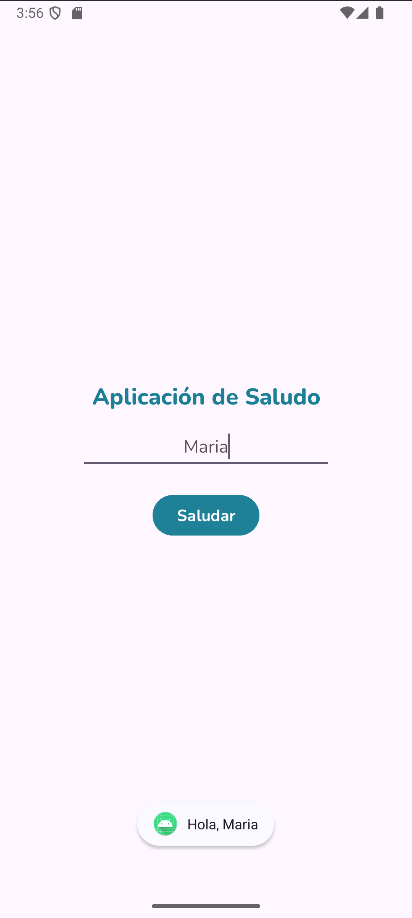

# SaludoApp

Android greeting app built with **Kotlin** in **Android Studio**

The user types their name and taps a button and a pop-up will show a personalized greeting, through a clean single-screen interface.

## Why

>Kotlin project developed in Android Studio to practice:
>
>- First steps with **Kotlin** and **Android Studio**
>- Designing a screen with **XML layouts** and **ConstraintLayout**
>- Use of UI components: **TextView**, **EditText** and **Button**
>- Managing text through **string resources** (`strings.xml`), including formatted strings with parameters
>- Customizing the look with **custom fonts** (Nunito, Open Sans, Playfair Display) and **color resources**
>- **Version control** using Git and GitHub

## Layout

